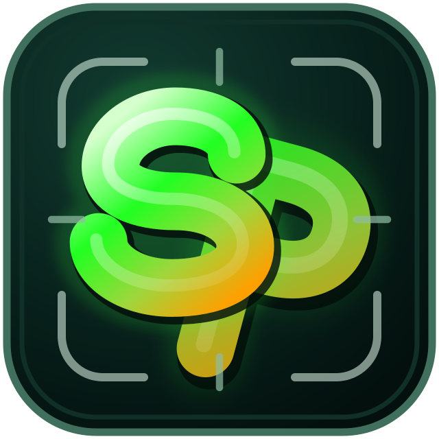

# Soul Pics — Current checkpoint

Updated: 2026-07-22
Status: v0.7.20 local prompt cutout, UI polish, bilingual guides, demo narration, clean submission packaging, and production build implemented; final verification and external submission steps remain.

## Version history

- v0.7.20: synchronized final guides and submission materials with the v0.7.19 UI and the assembled sub-three-minute English AI-voice demo.
- v0.7.19: localized the remaining Japanese-only labels in the English Background upload panel.
- v0.7.18: made horizontal/vertical flips mirror the currently displayed rotated subject and aligned hit-testing.
- v0.7.17: guaranteed the cutout processing overlay, fixed file-picker cancellation state, and removed stale placement-disclosure code.
- v0.7.16: removed the test-specific Japanese default Subject prompt so each UI language starts with an empty field and localized placeholder.
- v0.7.15: reconciled the final code with bilingual installation/user/specification/submission documents, pinned dependencies, and hardened release packaging.
- v0.7.14: aligned the lower edge of the B/I/U control group with the lower edge of the text-size slider.
- v0.7.13: added vertical subject flipping and text underlining; reorganized B/I/U as vertically stacked title-and-checkbox controls beside a narrower size slider.
- v0.7.12: renamed the English final-quality tab from Finish to Quality and aligned the English guide and narration terminology.
- v0.7.11: changed the copyright footer from restrained lime green to white, matching the primary Soul Pics title color.
- v0.7.10: restyled the copyright footer with a restrained lime green and matched its font size to standard explanatory copy.
- v0.7.9: rearranged subject placement controls to Size/Rotation and X/Y rows; normalized all four control sizes; kept Japanese and English labels on one line above unobscured controls.
- v0.7.8: extended the text-block heading design to Subject placement and the Color & tone, Depth & edges, Texture, and Shadow quality groups.
- v0.7.7: removed the Subject placement disclosure and made all placement controls permanently visible.
- v0.7.6: revised the bilingual final-quality local-processing notice to state clearly that no additional charges occur.
- v0.7.5: aligned the Canvas-top operation/output guidance color, size, and line height with the standard explanatory copy.
- v0.7.4: aligned the Subject local-processing explanation color, size, and line height with the final-quality explanation.
- v0.7.3: changed no-charge local-processing guidance to the normal explanation color while reserving orange for paid background generation.
- v0.7.2: revised the bilingual Subject explanation to describe local prompt conversion and Grounding DINO, SAM 2.1, and BiRefNet processing without additional charges.
- v0.7.1: repaired Japanese and English final-quality control headings so labels remain horizontal, visible, and clear of the stepper buttons.
- v0.7.0: replaced paid subject extraction with local Japanese normalization, Grounding DINO, SAM 2.1, and BiRefNet HR matting; preserved original dimensions/RGB; restricted OpenAI API use to background generation.
- v0.6.7: unified text-block hierarchy, centered all color labels, compacted crowded X/Y/spread/blur steppers, and moved outline-width/shadow-opacity labels next to their controls.
- v0.6.6: compacted the three text-style blocks into a one-screen 1080p layout while retaining the 28x30 px minus/plus controls.
- v0.6.5: reorganized text styling into Text / Outline / Shadow blocks with short contextual labels and a full-width font-size control.
- v0.6.4: replaced tiny native number spinners with explicit large minus/plus controls across all sliders and expanded the text-control layout for easier operation.

- v0.6.3: replaced the coupled text shadow size control with an independent Shadow spread / 影の広がり silhouette pass; spread no longer increases blur.

- v0.6.2: fixed text shadows by drawing an opaque text silhouette during the Canvas shadow pass before repainting the editable stroke and fill.

- v0.6.1: renamed the local recommendation button to Recommended auto adjust / おすすめ自動調整.

- v0.6.0: replaced prompt/button-based blending and paid AI lighting with non-destructive local final-quality analysis, Weak/Standard/Strong presets, visible real-time controls, and a reset that preserves assets, placement, and text.

- v0.5.2: removed the redundant local-blending checkbox so the three action buttons and reset controls determine the active blending method.
- v0.5.1: clarified the Japanese and English quality selectors as GPT Image 2 quality controls for background generation and AI lighting.
- v0.5.0: added paid GPT Image 2 whole-scene lighting while preserving the no-API local lighting path, original layers, editable text, and AI-result ON/OFF comparison.

- v0.4.4: added the background section heading, vertical upload controls, visible upload label, prompt-cutout API caution, and brighter blend guidance.
- v0.4.3: extended the selected background source panel border to cover the available display area by making the editor a flex column.
- v0.4.2: extended the selected background source panel border to cover the available display area.
- v0.4.1: expanded the left control viewport so the selected source panel can use the full available height.
- v0.4.0: started alternate exclusive background-source switcher layout with left/right controls and one expanded panel.
- v0.2.17: unified the prompt-generation and background-upload disclosure summaries so their font family, size, weight, line height, and alignment match.
- v0.2.18: unified collapsed background source button dimensions and left alignment.

## Canonical project state

- Project root: `Soul_Pics_Build_Week`
- App: Vite + React frontend with local Express API server
- UI languages: English / Japanese switch
- API key: optional and used only for background generation
- Image viewer: `.codex-image-preview/preview_viewer.html`

## Official logo

- Adopted design: centered SP monogram V11 with a subtly darker P
- Canonical SVG: `public/brand/soul-pics-logo.svg`
- Canonical PNG: `public/brand/soul-pics-logo.png`
- App icon: `public/brand/soul-pics-logo-192.png`
- Candidate source: `work/logo-candidates/soul-pics-sp-centered-p-darker10-v11.*`
- Adoption commit: `92796ec`
- Applied to the app header, favicon, Apple Touch Icon, and every current Markdown document

## Implemented application capabilities

- Canvas presets, custom size, background fit/position controls
- Uploaded or AI-generated background workflow
- Uploaded subject and API-free local prompt-cutout workflow
- Subject placement, rotation, flip, brightness, contrast, and asset saving
- Multiple draggable text layers with font, color, outline, shadow, bold, italic, and underline controls
- Local no-API final-quality analysis with Weak / Standard / Strong recommendations
- Real-time background blur, tone, temperature, edge, color-spill, sharpness, grain, and shadow controls
- Non-destructive reset that preserves original assets, placement, and text
- Processing overlay timed to actual user-to-computer work
- Preview and PNG export share the same Canvas renderer
- Responsive one-screen tab-oriented editor layout

## Verification completed

- `npm run build` passes with Vite 8.1.5
- Japanese prompt normalized locally to `red bass guitar`; Grounding DINO confidence 0.9029
- Direct local processing and real `/api/mask` route produced byte-identical 5712×4284 RGBA PNGs
- Full-frame, headstock, body-edge, and alpha-matte quality gate passed; peg bags remain as an accepted limitation
- Official app logo loads at 640×640 and renders at 64×64 in the header
- Browser console has no warnings or errors in the verified initial screen
- All current Markdown files reference the official logo
- Official 640px PNG is byte-identical to the adopted V11 candidate
- UI verification image: `work/qa-official-logo-app.png`

## Next meaningful work

1. Decide whether to run the one remaining paid Low-quality background generation test.
2. Record the English demo and review captions/narration.
3. Create the final thumbnail with Soul Pics.
4. Choose the public hosting/submission destination.
5. Scan, archive, checksum, and submit the final package.

## Continuity note

Earlier logo candidates and comparison images remain under `work/logo-candidates/` as design history. Continue from the official V11 assets above; do not resume candidate exploration unless the user explicitly requests it.
