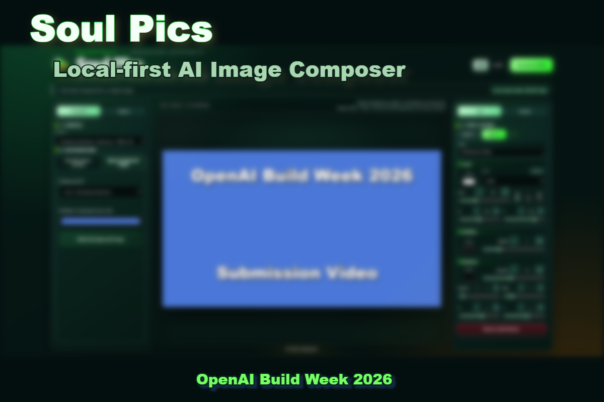
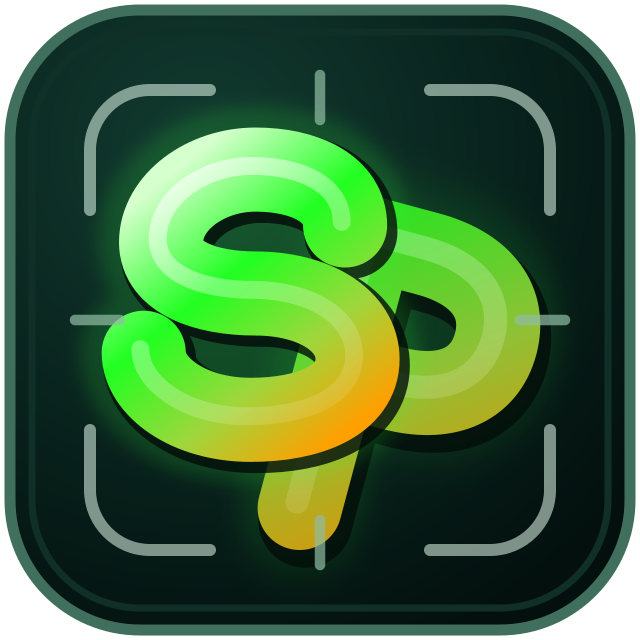

# Soul Pics v1.0.7





**Say what to keep. Place it anywhere. Add the words that make it yours.**

Soul Pics is a local-first image composer for posters, social assets, and thumbnails. Backgrounds, subjects, and text stay as independent layers, and preview/export share one Canvas renderer.

## What changed in v1.0.1

Local development UI refinement: shared label/value sizes, brighter readable placeholders and disabled controls, lime-based active tabs, stacked range controls, and responsive layouts without control overlap. Canvas rendering and AI processing are unchanged; the submitted v1.0.0 remains preserved.

See the [implementation and verification report](docs/ja/09_UI_REFINEMENT_2026-09-30.md), including the current Google Drive dependency-installation limitation.

## What changed in v0.7.1-v1.0.0

- Added per-text caption backgrounds with adjustable color, opacity, padding, corner radius, and local blur.
- Refined bilingual explanatory copy and made local/no-charge versus paid/API guidance visually distinct.
- Standardized explanatory text color, size, and line height across the Subject, Canvas, and final-quality areas.
- Made Subject placement controls permanently visible and reorganized them into Size/Rotation and X/Y rows.
- Unified block-heading design across Text, Subject placement, and all final-quality groups.
- Normalized placement control dimensions and prevented Japanese and English labels from wrapping or colliding with buttons.
- Aligned the copyright footer size with explanatory copy and finalized its color as white to match the Soul Pics title.
- Renamed the English final-quality tab from **Finish** to the clearer **Quality**.
- Added vertical subject flipping and text underlining, with compact B/I/U controls aligned beside the size slider.
- Matched the B/I/U control-group lower edge precisely to the text-size slider.
- Reconciled the bilingual installation, user, specification, and submission documents with the final UI and hardened the submission ZIP contents.
- Removed the test-specific default cutout prompt so each UI language starts cleanly with its localized placeholder.
- Fixed processing-overlay timing and file-picker cancellation cleanup before final recording.
- Made horizontal and vertical flips mirror the currently displayed rotated subject.
- Removed the final hard-coded Japanese labels from the English Background upload panel.

See [`CHANGELOG.md`](CHANGELOG.md) for the recovered per-change version history.

日本語の導入手順は [`docs/ja/00_PACKAGE_INDEX.md`](docs/ja/00_PACKAGE_INDEX.md) から始めてください。

## What is new in v0.7.0

- Prompt-based subject cutout now runs locally with Japanese-to-English normalization, Grounding DINO, SAM 2.1, and BiRefNet HR matting.
- The cutout preserves the source dimensions, aspect ratio, and RGB pixels while generating a refined alpha channel.
- Prompt-based background generation runs through the signed-in Codex App Server; the Soul Pics OpenAI API key is not used.
- Final-quality adjustment, normal editing, cutout, preview, and PNG export are API-free.
- Local models are downloaded during setup and loaded offline during normal use.

## Windows setup

```bat
cd /d C:\path\to\Soul_Pics
npm ci --no-audit --no-fund
npm run setup:local-ai
```

The local AI setup requires Python 3.12, an NVIDIA GPU with a current driver, internet access for the initial model download, and several gigabytes of free disk space.

Codex subject cutout and background generation require the Codex CLI to be installed and signed in. They use the Codex plan and do not require an `OPENAI_API_KEY` in Soul Pics.

## Run

Double-click `scripts\start-soul-pics.cmd`, or open two terminals in the project folder:

```bat
npm run server
```

```bat
npm run dev
```

Open the Vite URL, normally `http://127.0.0.1:5173/`.

## AI and cost boundary

| Action | Processing | OpenAI API key |
|---|---|---|
| Prompt subject cutout | Local translation + Grounding DINO + SAM 2.1 + BiRefNet | No |
| Codex subject cutout | Signed-in Codex task with imagegen | No; uses Codex plan |
| Prompt background generation | Signed-in Codex task with imagegen | No; uses Codex plan |
| Placement, text, final adjustment, export | Browser / Canvas 2D | No |

Codex tasks start only after an explicit button click. There are no automatic retries.

## ChatGPT Work cutout experiment

In the Subject panel, select **Try with ChatGPT Work** to create a temporary exchange folder and copy a prompt containing the absolute source and result paths. In ChatGPT desktop Work, open and grant access to that local folder, then paste the prompt without attaching the image. Work should read `source.*` from the path and save its transparent PNG as `result.png`; Soul Pics watches for a valid PNG with alpha and loads it automatically. If Work local access is unavailable, attach the source image manually as a fallback. The source and result stay on this PC; this feature does not call the OpenAI API. Jobs time out after one hour, and temporary exchange folders are removed after 24 hours.

## Codex cutout experiment

In the Subject panel, select **Cut out with Codex**. Soul Pics sends the selected image and prompt to a new local Codex App Server task, which receives the image as a local image input and saves its transparent PNG as `result.png`. Soul Pics waits for Codex to finish, validates that the result is a decodable PNG with transparent pixels, and imports it into the subject layer. Completion reports how many image-generation tool calls were observed; lifecycle details are saved in `codex-activity.json` in the temporary job folder. This counts separate tool invocations, not any internal retry hidden inside one invocation. The Codex CLI must be installed and signed in. The task uses the Codex plan and does not use the Soul Pics OpenAI API key. Jobs time out after one hour and exchange folders are removed after 24 hours.

## Codex background generation

In the Background panel, enter a prompt and select **Generate AI background**. Soul Pics sends the prompt and the current canvas width and height to a local Codex App Server task without an input image. Codex saves a PNG, and Soul Pics crops/resizes it to the exact canvas dimensions before importing it into the background layer. This uses the signed-in Codex plan, not a Soul Pics OpenAI API key. The generated image is editable and repositionable like an uploaded background.

## Verify

```bat
npm run check
```

The submitted v1.0.0 baseline is preserved by the v1.0.0 Git tag. Post-release cleanup and future work should be performed on a feature branch and verified before merging.

## Source layout

- src/main.jsx: application state, user actions, API/local-worker orchestration, and page composition
- src/canvasRenderer.js: the shared preview/export renderer, final-quality analysis, and Canvas hit testing
- src/projectConfig.js: presets, defaults, version display, font helpers, and stored-language handling
- src/components/Controls.jsx: reusable control groups used by the editing panels
- src/styles.css: application layout and visual design
- src/uiRefinements.css: v1.0.1 typography, lime palette, and adaptive-control overrides
- server/index.js: local HTTP endpoints and the optional OpenAI background-generation boundary
- local_ai/: local subject-cutout worker and model pipeline

See [docs/05_DEVELOPMENT_GUIDE.md](docs/05_DEVELOPMENT_GUIDE.md) before changing renderer or processing behavior.

Model licenses and attribution links are listed in [`THIRD_PARTY_MODELS.md`](THIRD_PARTY_MODELS.md).

## License

Soul Pics source code is released under the [MIT License](LICENSE). Third-party models and dependencies remain subject to their respective licenses; see [`THIRD_PARTY_MODELS.md`](THIRD_PARTY_MODELS.md).

## Build Week submission links

- Public source repository: https://github.com/Jangroove/soul-pics
- Public 2:35 YouTube demo with English audio: https://youtu.be/pDBDTgWetPk
- Judge test path: clone this repository and follow `docs/en/01_INSTALL_GUIDE.md`
- Primary Codex Session ID: `019f753f-dc7e-7a10-b2f6-61f2fa4d3f07`
- The Devpost thumbnail was composed and exported in Soul Pics itself.
