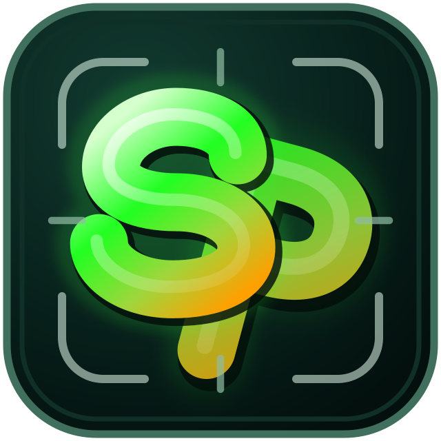

# Soul Pics プロジェクト解説書・仕様書 v0.7.20



## 1. 概要

Soul Picsは、背景・被写体・テキストを独立レイヤーとして扱うローカルWeb画像編集アプリです。React/ViteのUIとCanvas 2Dレンダラーを使い、プレビューとPNG出力を同じ描画経路で生成します。

AI関連の責務は次のように分離します。

- 被写体切り抜き：PC内のローカルモデル。OpenAI API不使用。
- 背景自動生成：ユーザーが明示実行した場合だけGPT Image 2 APIを使用。
- 最終画質調整：Canvas 2Dによるローカル処理。API不使用。

## 2. システム構成

```text
React / Vite UI
  ├─ Canvas renderer
  │    ├─ background
  │    ├─ subject
  │    ├─ text
  │    └─ PNG export
  └─ Node.js / Express (loopback)
       ├─ GET  /api/health
       ├─ POST /api/mask
       │    └─ local Python worker
       │         ├─ opus-mt-ja-en
       │         ├─ Grounding DINO
       │         ├─ SAM 2.1
       │         └─ BiRefNet HR-matting
       └─ POST /api/background
            └─ OpenAI GPT Image 2
```

ローカルAIモデルはセットアップ時に取得し、通常実行時はオフラインモードで読み込みます。OpenAI APIキーはNodeサーバーだけが `.env` から読み、ブラウザへ渡しません。

## 3. データフロー

### 3.1 ローカル切り抜き

1. ユーザーが元画像と日本語または英語の対象指示を入力する。
2. ブラウザが元画像を `/api/mask` へ送る。
3. 日本語の場合はopus-mt-ja-enで検出向け英語ラベルへ変換する。
4. Grounding DINOが対象候補と矩形を検出する。
5. SAM 2.1が矩形内の被写体マスクを生成する。
6. BiRefNet HR-mattingが高解像度アルファを生成する。
7. セマンティック領域と精細アルファを融合し、内部の小さな透明欠けを保護する。
8. 元画像のRGB・幅・高さを維持したRGBA PNGを返す。

この経路ではOpenAI APIを呼びません。同一画像・同一指示は最大3件のメモリキャッシュを利用します。

### 3.2 背景生成

1. ユーザーが背景プロンプトとLow / Medium / Highを選ぶ。
2. 明示的に生成ボタンを押す。
3. NodeサーバーがGPT Image 2へ1回送信する。
4. 生成PNGを背景レイヤーへ読み込む。

SDKの自動再試行は0です。失敗時にアプリが自動で再実行することもありません。

### 3.3 編集・仕上げ・出力

配置、回転、反転、テキスト、最終画質調整、プレビュー、PNG出力はブラウザ内で完結し、APIを使用しません。

## 4. API仕様

| 経路 | 役割 | 外部API |
|---|---|---|
| `GET /api/health` | ローカル切り抜き・背景AIの準備状態 | なし |
| `POST /api/mask` | 指示対象の透過PNG生成、最大50MB | なし |
| `POST /api/background` | GPT Image 2背景生成 | OpenAI API |

`/api/mask` の応答は `image/png` で、`X-Soul-Pics-Local-AI: true` を付与します。

## 5. 主要機能

- YouTube横長、縦長、正方形、Xヘッダー、プロフィール、カスタムCanvas。
- 背景のアップロード、フィット、位置調整、任意のAI生成。
- 被写体のアップロード、ローカル切り抜き、位置、サイズ、回転、左右・上下反転。
- 複数テキストレイヤー、色、縁取り、影、太字、Italic、Underline。
- APIなしのおすすめ最終画質調整と手動微調整。
- 英語・日本語UI。
- 同一Canvas描画によるプレビューとPNG出力。

## 6. セキュリティ・プライバシー・コスト

- `.env`、APIキー、`.local-ai`、モデルキャッシュを配布ZIPへ含めない。
- ローカル切り抜き画像はOpenAIへ送信しない。
- OpenAI APIは背景生成の明示クリック時だけ使用する。
- 背景生成の初期品質はLow。
- OpenAI APIの自動呼出し・自動再試行を行わない。
- 通常編集と出力はローカルで実行する。

## 7. 動作要件

- Windows 10/11
- Node.js 22.12以上
- Python 3.12
- NVIDIA CUDA対応GPU（検証機：RTX 2060 6GB）
- 初回セットアップ時のインターネット接続と数GBの空き容量

BiRefNetは2048px推論を優先し、VRAM不足時は1536px、1024pxへ段階的に縮小します。出力PNG自体は元画像サイズです。

## 8. 受入条件

- [x] 日本語指示がローカルで英語ラベルへ正規化される。
- [x] 元画像5712×4284から同寸法RGBA PNGを生成できる。
- [x] 実際の `/api/mask` 経路がOpenAI APIなしで成功する。
- [x] 外周の境界に商品画像として問題となる顕著なジャギーがない。
- [x] 黒い内部パーツの透明欠けを保護する。
- [x] 本番Viteビルドが成功する。
- [ ] 背景生成の最終Low品質テストは、ユーザー承認時のみ実行する。
- [ ] 公開URL、動画、提出フォームは外部作業として完了させる。

## 9. 制約

- ペグ保護袋など対象に接触する物体は残る場合がある。
- 透明・半透明・反射物、毛髪、極細構造は目視確認が必要。
- 手動マスクブラシ、Undo / Redo、プロジェクト同期は未実装。
- ローカルモデルの初回取得には時間とディスク容量が必要。

## 10. 関連文書

- `docs/ja/01_INSTALL_GUIDE.md`
- `docs/ja/02_USER_GUIDE.md`
- `docs/en/03_PROJECT_SPEC.md`
- `THIRD_PARTY_MODELS.md`
- `submission/FINAL_SUBMISSION_CHECKLIST.md`
